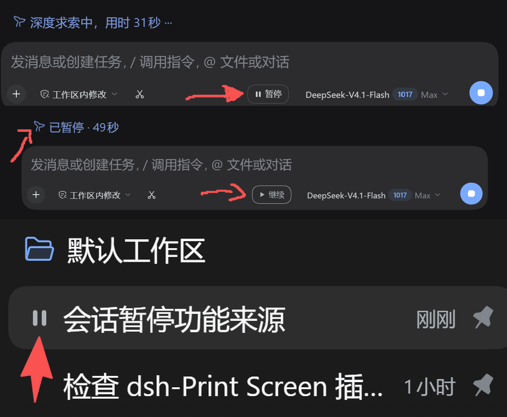

# dsh-breather

给 DSH 的对话加一个「暂停 / 继续」状态——介于「正在运行」和「终止」之间。

> **零成本暂停**：当前步骤做完后挂起，继续时不重发请求、不重复花 token；只有点继续或发新消息才接着跑，子代理结算与定时提醒唤不醒。侧栏显示暂停图标，计时器与动画冻结、不计暂停时段，恢复后从冻结值接着走。按钮区分「暂停中」与「已暂停」，暂停只作用于当前会话。



## 七点说明

1. **零成本暂停**：暂停本身不发出新请求。当前步骤做完后停住，只有手动点按钮或发送新提示词才会继续；后台行为（子代理结算、定时提醒等）唤不醒它。
2. **侧栏与计时**：左侧会话列表加入暂停图标；暂停期间计时器文字与动画冻结，计时器不计暂停时段，恢复后从暂停前的时间接着算。
3. **两种状态**：按钮区分「暂停中」（请求已发、当前步骤还在跑）与「已暂停」（闸门真的挂住）。
4. **作用域**：单次暂停只作用于当前会话。
5. **回合总结统计的是总时间**：那行「深度思考了 X」按 `turn.end - turn.start` 算，**包含暂停时段**。这是底层架构限制；为了兼容更多版本，插件不去改它——你可以自行修改，但改过的文件会随 DSH 版本更新失效。
6. **重启不保留暂停**：暂停后重启 DSH，再点「继续」本质上是终止对话并花 token 发了一条「继续」提示词。目前不存在关闭 DSH 后仍保持暂停的路径。
7. **计时模块坏了也不影响暂停**：如果 DSH 更新导致计时接管（核心 DOM 钩子）出错，只会退回核心原生显示，暂停 / 继续照常工作，**不会因此多消耗 token**。


## 它做什么

- 会话运行时，输入框右侧（模型选择器左边、停止按钮同一行）多一个 **暂停** 按钮。
- 点暂停：**当前这一步先跑完**（正在输出的回复、正在跑的工具都不打断），然后在
  **发起下一次模型请求之前**把这一轮挂住。按钮变成 **继续**。
- 点继续：闸门放行，模型从停住的地方接着跑。**不重发请求、不重复工作、不多花 token。**
- 挂住之前按钮显示「暂停中…」，此时再点一次等于取消这次暂停请求。
- 挂住之后，对话下方那行「深度求索中，用时 X」会冻住并变成「已暂停 · X」，流光动画
  一起停；**暂停的那段时间不计入**——继续之后从冻住的数字往下走，不会一下子跳掉。
- 左侧会话列表里，被暂停的那一行会把转圈圈换成蓝色的暂停符号；其他会话照常转。
- 那一行的悬停卡片里会多一行「已暂停 · 点输入框旁的「继续」从停住的地方接着跑」——
  这一处走的是核心本来就有的 `sidebar.session.row.hover` 插槽，不碰 DOM。
- 暂停期间按停止（或 Esc Esc）照常终止：闸门会跟着回合取消一起松开，不会卡住。
- **没有超时：暂停之后你不点继续，它就一直是暂停状态**，放一小时也一样。
- 暂停期间**你自己又发了消息**会自动恢复（当成「我要继续」）；子代理结算、定时提醒
  这类后台唤醒不会解除暂停。

## 它做不到什么

- **不能打断正在流式输出的那一条回复。** 暂停是「下一次请求前」生效，所以长工具
  调用 / 长回复期间点暂停，要等这一步结束才真正停住。想立刻停，用原来的停止按钮。
- 暂停只作用于**这一轮对话（turn）**；不会暂停子代理、后台任务和定时提醒。
- **同屏有子代理内嵌会话时，只接管主对话那个计时器**；如果核心的结构让插件认不出
  哪一个是主对话的（比如两个都在聊天节点外），它**一个都不改**并登记失效——宁可让
  数字继续走，也不把子代理的数字改成主对话的。
- 核心如果把「深度求索中，用时 1分23秒」拆成两个文本节点，插件只冻结里面的数字，
  不动标签；那种情况下不会显示「已暂停」几个字（数字停住本身就是信号）。

## 自检：接管失效时会怎样

有两处效果是靠核心的 DOM 钩子实现的（运行计时器冻结、侧栏行首图标）。核心改版把
这些 data 属性改名时，客户端会**在失效发生的几秒内发现**，而不是默默退化成原样：

- **计时器**：见过 `[data-chat-running]` 之后又连续 6 次（约 4.2 秒）找不到 → 登记 `timer`
  失效；一次都没见过（刚刷新、长会话还没渲染出来）则给 20 次（约 14 秒）宽限，避免把
  「还没渲染」误判成「钩子没了」。
- **侧栏行**：有 `[role="treeitem"]` 行，但**整页一个 `data-row-key` 都没有**时，才登记
  `rows` 失效——要求整页都没有，是为了不把文件树等别的树形控件误判成会话行改名。
- **计时器作用域**：页面上有多个 `[data-chat-running]`，但其中恰好没有一个能确定是主对话
  （不在聊天节点外、或不止一个在节点外）时，登记 `timer` 失效并**一个都不改**。这种失效
  不停掉 700ms 的重挂载循环，局面一清楚就自动恢复。

登记之后：控制台 `console.warn` 一次（带一句「其余功能正常」），暂停按钮的 title
追加「（部分接管失效：核心页面结构变了，详见控制台）」，并且**停掉对应的接管**
（停止 700ms 的重挂载循环），不再空转。功能本身（宿主闸门、按钮三态、继续零成本）
不受影响。

**失效标记会自愈**：钩子后来又出现时，连续两次轮询/重挂载都看到它，就撤销标记并
`console.info` 一句「xx 接管已恢复」——不会一次抖动就翻案，也不会一直挂着红字到刷新。

界面文案跟随核心的 `<html lang>`（读不到时看 `navigator.language`）：中文一套，**其他
语言一律英文兜底**（日语、法语用户看英文，而不是中文）；`暂停 / 继续 / 暂停中…`、按钮
title、行首图标与悬停卡文字都有中英两套。计时文案里的时长单位不是按界面语言猜的，而是
从核心那句真实文案里认——「已暂停」这三个字在没有证据时（只抓到数字）才回退到界面语言。

## 可选：把行首图标改由核心插槽渲染

原版核心的侧栏行首是二选一：运行中画状态点，空闲才渲染
`sidebar.session.row.leading` 插槽——所以暂停图标只能靠 DOM + mask 补。想让图标也走
上游插槽，可以打一个本地补丁（**改的是安装包 `app.asar`，不是插件**）：

```powershell
# 只检查（默认，什么都不改；预览写系统临时目录）
node tools/patch-core-row-slot.mjs --check

# 想在仓库里留下打过补丁的副本来看 diff
node tools/patch-core-row-slot.mjs --check --preview

# 完全退出 DSH 后，用有写权限的终端打补丁
node tools/patch-core-row-slot.mjs --apply
# 还原
node tools/patch-core-row-slot.mjs --restore
```

它做的事：把 `showStatus ? 状态点 : 插槽` 改成「插槽先渲染、状态点照旧」，新代码多出
的 77 字节从紧邻的文档注释里扣回来，因此**文件字节数不变**；再把该文件新的 SHA256
写回 asar 头的 `integrity.hash` / `integrity.blocks[0]`。asar 总大小与其余条目都不动，
备份留在 `tools/.backup/`。

补丁生效后，插件对“行”的 DOM 依赖会再降一层：**不再给行打标记**，藏核心状态点改成
CSS 按「这一行里有没有我们的图标」自己算（`[data-row-key]:has([data-dshp-row-icon])` 和
`*:has(> [data-dshp-row-icon])` 两条规则，兼容插槽输出被包一层的情况）。所以补丁模式
下就算行键改名，最坏也只是“暂停符号和转圈并排”，不会整个图标消失。

风险和边界，先说清楚：

- 脚本带版本与哈希双锚点（核心 `0.2.1-rc.3`，文件 SHA256 固定）。DSH 升级后两者对不上，
  它会直接拒绝，不会瞎改。
- 改的是安装包，升级/重装 DSH 会被覆盖，需要重新打；不打也完全能用（回到 mask 方案）。
- 打了补丁之后，插件渲染图标时会自动给 `<html>` 加 `data-dshp-rowslot`，CSS 里的 mask
  规则随即让位，不会画两遍。

## 安装

```powershell
dsh plugin --profile desktop add dsh-breather
```

装了之后**完全退出 DSH 再打开**（宿主半只在启动时加载）；浏览器半随页面刷新生效。

包声明了 `dsh.bundle`，安装时会把 `cordis.patch.yml` 这一层追加进 profile，宿主半作为一个
普通插件行被注册；浏览器半由 Web 端按 `dsh.client.platform` 自动加载。`engines.dsh` 写的是
`>=0.2.1-rc.2 <0.3.0-0`——**下界必须带 `-0`**，否则 semver 不匹配 `0.2.1-rc.x` 这类预发布版本，
rc 版 DSH 会直接拒绝安装。卸载：

```powershell
dsh plugin --profile desktop remove dsh-breather
```

### 旧安装怎么办（只和开发机有关）

老包名是 `dsh-session-pause`，老装法是「Junction + 手写 patch row」。**不用迁移**：Node 按
目录名解析，旧 row 照样能加载，包名对不上只影响 `dsh plugin list` 的观感。硬要换装的唯一
红线是：**先删 profile 里手写的那一行，再 remove 旧依赖**——反过来（先删依赖、留着 row）
DSH 下次启动会直接报找不到模块，那才是真的起不来。

**但换装会顺手弄坏别的东西**：`pnpm add/install/remove` 会把没写进 `dependencies` 的手装
插件目录挪进 `node_modules\.ignored\`（`dsh-session-folder`、`dsh-session-delete` 这类）。
所以验证"发布出去的包"别动主 profile，用一次性的独立 profile：

```powershell
dsh --profile breathe-test --from-default-profile desktop   # 建一个干净 profile
dsh plugin --profile breathe-test add dsh-breather          # 从 npm 装（未发布时可 add <插件目录>）
dsh --profile breathe-test                                  # 起来点一遍，验完关掉、删掉这个 profile
```

### 本地开发

源码目录沿用了历史名字 `<workspace>/.dsh-plugins/dsh-session-pause`，主 profile 里仍以
**旧包名**挂着（Junction），改源码立刻生效。这条路径只适合开发机；正常用户走上面的
`dsh plugin add`。

## 配置（`cordis.patch.yml` 的 `config`）

| 字段 | 默认 | 说明 |
|---|---|---|
| `enabled` | `true` | 总开关 |
| `engagedTimeoutMs` | `0` | 可选的挂住超时；`0` = 永不自动放行（默认）。只有自己明确填毫秒数才会兜底放行 |

路由**不可配置**：固定是 `/api/session-pause`，浏览器半把这条路径写死了。以前留过一个
`path` 配置项，结果只有宿主听那个开关——一改客户端就永远读不到状态，是最难查的一类故障。
填了也不会生效（0.3.0 起移除）。

## 实现

宿主半（`index.js`）：

- `ctx.on('agent/pre-step', …)`：`dsh-agent-loop` 在每次发起模型请求前用
  `dispatch.waterfall` 调用这个钩子，且会 `await` 监听器返回的 Promise。所以在这里
  `await` 一个闸门就等于把这一轮挂住；松开后 `return next()` 继续。
- 中止信号来自钩子载荷里的 `signal`（本回合的 AbortSignal）：停止 / 取消时它 abort，
  闸门立刻松开并返回 `{ kind: 'reject' }`，回合按取消路径干净结束。
- `ctx.connection.fetch.register({ path, methods: ['GET','POST'] })`：状态查询与
  暂停 / 继续操作；精确路由只有 owner peer（本机浏览器）能访问。
- 回合结束（`agent/status` 非 running）清掉暂停状态，避免残留到下一轮。
- 用户消息（`source.kind === 'user'`）进入 inbox 时自动恢复；其他来源的唤醒不解除暂停。
- 默认没有超时定时器，闸门只由「继续 / 用户发言 / 回合被终止 / 插件卸载」松开。
- 计时基准：浏览器在暂停挂住时把「这一轮已经跑了多久」上报（`action: 'baseline'`），
  宿主存在会话状态里并随快照返回；继续时记下「继续时刻」，继续之后这一轮没结束前都以
  `clocks` 的形式留在快照里。所以刷新页面、切走会话再回来，扣减不会丢。
- 再次暂停（`requestPause`）时，宿主先按「上次继续到现在」把基准走一遍再进入暂停。
  这样 `baseMs` 永远是此刻的准确值——浏览器本地状态哪怕丢了（刷新、切走），拿到的
  也不会是上一轮的旧数字。

浏览器半（`client.js`）：

- 以 `window.__ModuleLoader__.load({ id: 'dsh-breather', … })` 注册，导出一个
  普通 cordis 插件（`name` / `inject` / `apply`），只用 `react`，不依赖任何 Remote
  或生成代码。
- 注册到 `conversation.input.right`（`kind: 'list'`, `scope: 'session'`）插槽；
  `inject: (sessionId) => ({ pauseSessionId: sessionId })` 拿到当前会话（用独立
  prop 名，避开与标准 props 撞名）。
- 全局轮询 `/api/session-pause`（前台 900ms、后台 4s），所有输入框共用一份快照，
  会话不在运行时组件返回 `null`，不占位。宿主路由 404（插件被禁用 / 还没注册上）时
  **连续两次才认定、然后降到每 20 秒探测**，恢复后自己回来——一次 404 就永久藏按钮的话，
  DSH 启动早期那一次探空会让功能凭空消失。
- 点暂停 / 继续发的是**目标状态**（`pause` / `resume`），不是 toggle：按钮上的状态可能比
  宿主慢半拍，宿主对重复动作幂等，发错方向的代价却很大。请求 5 秒超时；超时**不算失败**
  （POST 可能已经落地），而是立刻重新读一次宿主状态。宿主明确回绝（`session/idle` 这类
  竞态）时，按钮**旁边**出现一句话，**不替换按钮自己的状态文字**——否则用户看不出还能
  不能继续。
- 运行计时器由 chat 插件的 `RunningStatus` 渲染，它只看「会话是否 running」，每秒用
  `Date.now() - startTime` 重算，核心没给这段文案留插槽。这里不覆盖核心包，而是对该
  元素挂一个 `MutationObserver`：React 每次提交后（同一帧绘制前）把可见文案换成自己的
  值——暂停时写「已暂停 · X」，继续后写「前缀 +（墙钟 − 累计暂停）+ 后缀」。
  **`TextShimmer` 的文字分两层，两层长得不一样**：基础层是普通文本节点；扫光高亮层
  没有文本节点，文字放在 `data-shimmer-text` 属性里，由 CSS
  `._text:after{content:attr(data-shimmer-text)}` 渲染。只改文本节点会让高亮层保留核心
  写的旧数字、叠出一个重复的时间——所以**文本节点和属性都要写**，测试按这个结构建了
  假 DOM。
  前缀、后缀和时长单位都从第一份真实文案里解析出来（不猜语言、不硬编码模板），
  时长按核心同样的规则重新拼（有小时才写小时、满 60 秒才写分钟）。
  **每个文本节点/扫光元素各记各的前后缀**（第一次见到时抓，之后不再重新解析），
  而且只写「本来装着时长」的节点：容器里别的一律不碰，核心把文案拆成两段时也只冻数字。
  只接管主对话那个计时器：子代理内嵌会话的在 `[data-chat-node-key]` 里面，排除；
  排除后如果还剩不止一个、或者一个都不剩（认不出），就**一个都不改**并登记失效。
  元素被 React 重建时按 700ms 重新挂靠，基准值保持不变。回合结束或切走会话就交还。
- 什么时候交还，**不看 DOM 新鲜度**：React 每秒才写一次文案，后台标签页的定时器还会被
  节流到每分钟一次，"核心写的数字比基准小"很容易是滞后而不是换轮。改成看宿主快照里的
  `clocks`：继续时宿主记下 `baseMs + resumedAt`，一旦这一轮的基准没了（换轮、回合结束、
  宿主重启），客户端在宽限 3 秒后交还控制权。
  **暂停中不算「没有基准」**：点暂停的那一刻宿主本来就不给 clock，所以只要会话还出现在
  `paused` 里（含还没挂住的「暂停中…」），本地基准必须留着，否则二次暂停会退回旧数字。
  暂停时给这一个计时器元素加 `data-dsh-timer-paused`，CSS 只停它的扫光动画
  （`animation-play-state:paused`）——用全局标记会把子代理内嵌会话的扫光也一起停掉。
- 侧栏会话行：行元素带 `[data-row-key="session:<id>"]`，运行中显示
  `svg[data-state="ongoing"]` 转圈。给「已挂住」的会话行加 `data-dsh-paused-session`
  属性（每次轮询对齐一遍，行被重建也会补上），CSS 隐藏那个 svg，再用 mask 在行首画
  一个暂停符号——不碰 hashed class，也不覆盖核心包。
- 行钩子有两套选择器（`[data-row-key^="session:"]` 和 `[role="treeitem"][data-row-key]`），
  同一行用 `Set` 去重；核心把 `data-row-key` 改名（树还在、键没了）时登记 `rows` 失效。
- 另外注册了两个上游插槽：`sidebar.session.row.leading`（行首图标；**原版核心只在该行
  空闲时渲染它**，打了 `tools/patch-core-row-slot.mjs` 才会在运行中也渲染）和
  `sidebar.session.row.hover`（行悬停卡的一行状态字，原版就可用）。前者渲染时给
  `<html>` 加 `data-dshp-rowslot`，mask 规则据此让位，避免画两遍。
- 自检：`[data-chat-running]` 见过之后连续 6 次（约 4.2 秒）找不到就登记 `timer` 失效并
  停掉 700ms 重挂载循环（一次没见过则宽限 20 次）；失效只 `console.warn` 一次，同时把
  `degraded` 带进快照，按钮 title 会显示「部分接管失效」。
- 会话行组件只订阅「本行状态」这个整数（`useRowPauseKind`），不是整份快照——否则几百个
  会话行会因为别处一次暂停全部重渲染。

## 0.3.0 改了什么

- 插件改名为 **dsh-breather**：npm 包名、cordis 插件名、`__ModuleLoader__` id、样式 id 全部
  跟着改；**HTTP 路由仍是 `/api/session-pause`**（内部路径，改它只会多一类"两边不同步"的故障）。
- **计时器接管限定在主对话**：子代理内嵌会话的计时器不再被改写；同屏认不出哪一个是主对话
  时一个都不动，并登记失效（局面清楚了自愈）。
- 只覆盖「本来就装着时长」的文本节点和扫光属性；核心把文案拆成两段也不会写出重复数字。
- 点暂停失败会给一句话（**竞态**和**结果未知**分开说），不再静默；请求 5 秒超时，超时后
  立刻重新同步状态而不是报错。
- 宿主路由 404 时降频探活（20 秒一次），恢复了自动接上；不再 900ms 空转。
- 宿主侧：垃圾条目会回收，但**暂停中的状态永不主动删除**；agent 消失的「幽灵暂停」只是
  不上报，闸门状态保留。
- `path` 配置项移除（客户端写死同一条路由）；`recordBaseline` 超过 30 天直接拒绝。
- 非中英文界面按英文兜底； `<style>` 按版本替换，插件升级后不用刷新两次。
- npm 包里不再带 `tools/`——那个会改 `app.asar` 的补丁工具只留在仓库里。

## 自测

```powershell
npm test              # 三套单元/集成测试
node tools/browser-rig.mjs     # 真浏览器台架：真 Edge + 真 React + 真 DOM/CSS（29 项）
node tools/check-release.mjs   # 上架前检查（元数据 / 打包内容 / 列表条目 / 端点一致性）
node tools/patch-core-row-slot.mjs --check   # 核心补丁的版本、哈希、等长与语法校验（只读）
```

- `node test.mjs`：宿主半——状态机 / 闸门 / 取消 / 无超时 / 基准限额 / 回收 / 幽灵暂停。
- `node test-apply.mjs`：`apply()` 装配 + HTTP 路由全链路 + 路由注册失败不静默。
- `node test-client.mjs`：浏览器半 25 个场景（按钮三态 / 计时器冻结与扣减 / 子代理作用域 /
  拆开的文本节点 / 失败提示 / 404 降频 / 语言兜底 / 样式版本 …）。
- `tools/browser-rig.mjs`：本机 Edge 无头跑一个迷你面板（mock 宿主），验证 `:has()` + mask
  真的画出 14px 暂停符号、转圈真的被藏掉、计时器与扫光层同步、子代理计时器不动、
  插槽图标模式让 mask 让位。**这是唯一能验证 CSS/DOM 这一层的地方**——单测的假 DOM 做不到。
- `tools/browser-smoke.mjs`：打真实 DSH Web GUI。注意 `dsh web` 的地址带 token
  （`.../?token=...`），直接开裸地址会 401；把带 token 的地址用 `--url=` 传进来。
- `tools/check-release.mjs`：`repository` 还是 `OWNER` 占位符时会失败，这是故意的。

不带参数就是无头；想亲眼看加 `--headed`。台架需要联网下载一次 React（存到
`smoke/vendor/`，之后离线可用），截图与报告落在 `smoke/out/`（已 gitignore）。
浏览器进程需要能写自己的 profile / 用命名管道，在 DSH 沙箱里会 `FATAL:mojo` —— 这一步要在
沙箱外跑。

`tools/`、`test*.mjs`、`packaging/` **不进 npm 包**（`package.json` 的 `files[]` 只列运行时
文件）：那个补丁工具会改安装包里的 `app.asar`，属于仓库里的实验性工具，不该跟着插件发给别人。

## 隐私

- 只和本机 `127.0.0.1` 上宿主插件注册的那条 `/api/session-pause` 说话，**不联网**、不上传任何内容。
- **不写文件**、不改核心、不读会话内容；状态只存在宿主进程内存里（重启即清空）。
- 唯一的例外是仓库里的 `tools/patch-core-row-slot.mjs`，它是可选的开发工具，**不在 npm 包里**。
